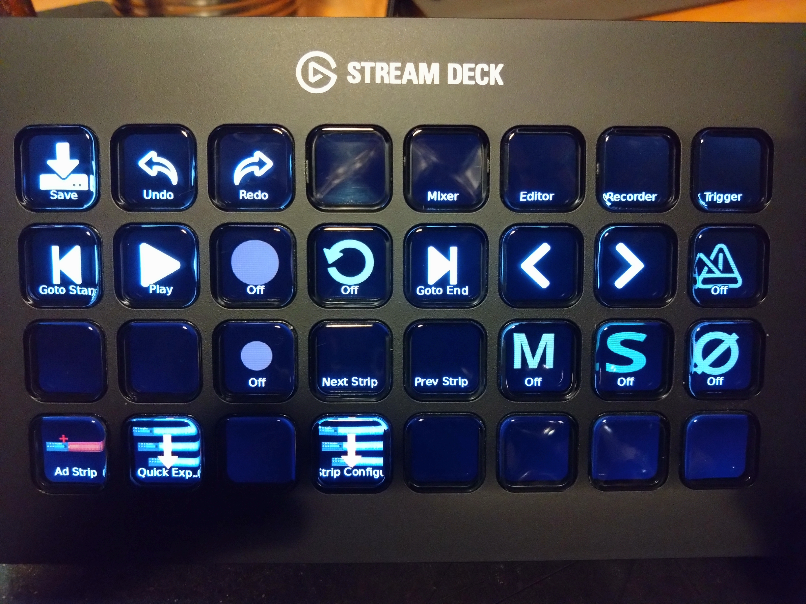
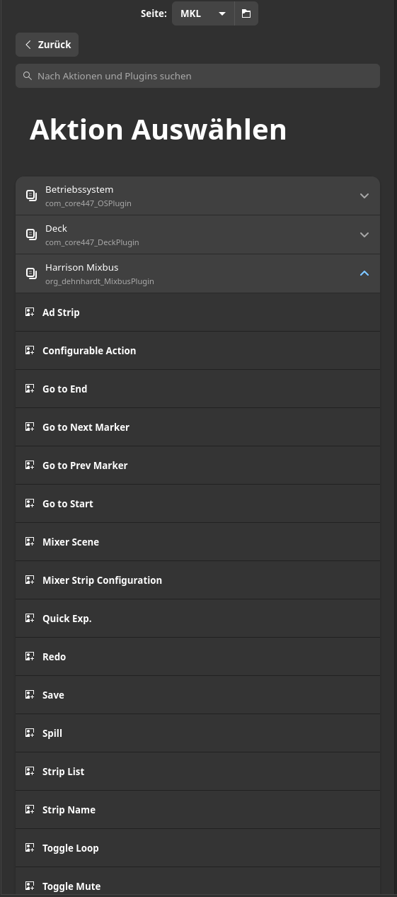
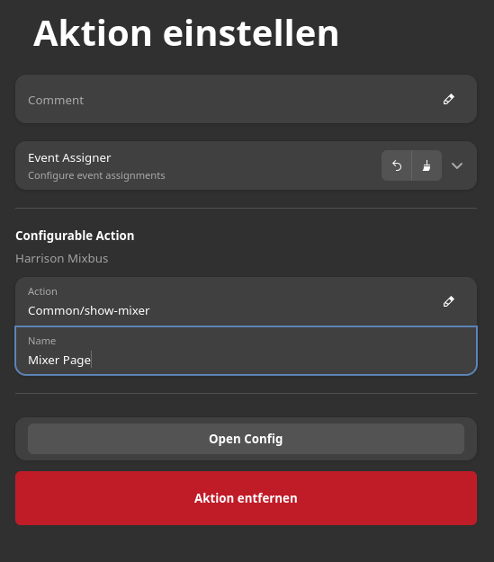
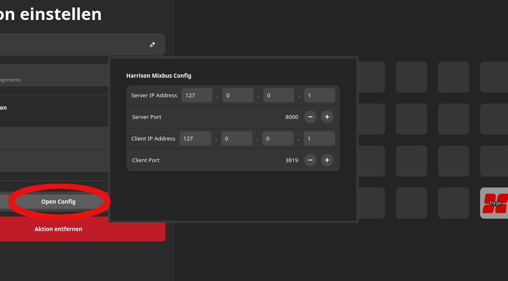

# Ardour / Mixbus Plugin for Elegato Stream Deck under Linux 

There is a powerful Python implementation for enabling Stream Deck in Linux: [Stream Controller](https://core447.com/)

I have written a plugin for it, which can control Ardour and Mixbus via the OSC protocol.

## Installation
If you have installed Stream Controller, you can simply add this plugin from the store page.

## Actions
A lot of buttons (called actions) are directly implemented (e.g. Play, Metronome, Mute, Solo...).

This has the advantage of having an icon directly assigned and reacting to feedback.

## Configurable Action
But there is an additional action (called 'configurable action' which can call any [Menu Action](https://manual.ardour.org/appendix/menu-actions-list/).
Simply add the action (e.g. Common/show-mixer) and a name (e.g. "Mixer Page"). In addition you can freely add an icon.

## Setup
If the Stream Controller is running on the same computer as Ardour/Mixbus, the default configuration, which can be found in the Stream Controller settings under Plugins (button "Open Settings" at the Harrison Mixbus plugin), should be ok.
Otherwise you need to change the IP adresses.

## Trigger page
The actions "Trigger Clip" and "Trigger Control" control the cue (trigger) grid of Ardour/Mixbus.
The "Create" button in the plugin settings builds a page for the connected deck: the clip slots fill the keys, the last column scrolls the visible rows up and down and stops all clips.
Delete an existing page of the same name ("Mixbus Triggers") first.

## Changes
See [CHANGELOG.md](CHANGELOG.md).
